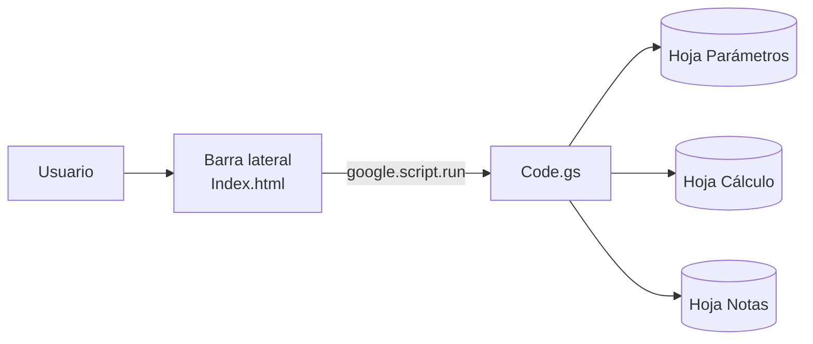

<div align="center">

# Calculadora de aguinaldo México 2026

**Hoja de cálculo de Google con Apps Script y una barra lateral en HTML/JavaScript vanilla para calcular el aguinaldo, la exención de ISR y el neto estimado.**


</div>

> [!IMPORTANTE]
> **Precisión legal sobre la exención:** el aguinaldo está exento de ISR hasta **30 UMA diarias**, no 30 veces la UMA anual. Para 2026: `30 × $117.31 = $3,519.30`. Si se usara `30 × UMA anual`, el exento sería `$1,283,839.20`, muy superior al criterio legal y al que revisa el SAT.

> [!WARNING]
> **Descargo de responsabilidad:** esta herramienta es informativa y **no sustituye** la asesoría de un contador público, un abogado laboral ni la determinación oficial de nómina. Antes de pagar o timbrar, confirma los parámetros vigentes y el caso particular del trabajador.

---

## Contenido

- [Descripción general](#descripción-general)
- [Características](#características)
- [Arquitectura y tecnologías](#arquitectura-y-tecnologías)
- [Requisitos](#requisitos)
- [Instalación](#instalación)
- [Uso](#uso)
- [Estructura de hojas](#estructura-de-hojas)
- [Fórmulas y método de cálculo](#fórmulas-y-método-de-cálculo)
- [Ejemplo verificable](#ejemplo-verificable)
- [Marco legal y tratamiento fiscal](#marco-legal-y-tratamiento-fiscal)
- [Actualización anual](#actualización-anual)
- [Limitaciones y descargo](#limitaciones-y-descargo)
- [Solución de problemas](#solución-de-problemas)
- [Fuentes](#fuentes)
- [Licencia](#licencia)

---

## Descripción general

Esta hoja de cálculo permite estimar el aguinaldo de un trabajador en México para el ejercicio **2026**, incluyendo:

- Aguinaldo proporcional por días laborados.
- Parte exenta y parte gravable de ISR.
- ISR atribuible al aguinaldo.
- Cuotas obreras del IMSS estimadas.
- Otras deducciones capturadas por el usuario.
- Monto neto a recibir.

La interfaz se abre como una **barra lateral dentro de Google Sheets**. El backend está escrito en Google Apps Script y el frontend en HTML, CSS y JavaScript vanilla, sin frameworks ni dependencias externas.

La lógica fiscal vive en `Code.gs`; la hoja **Cálculo** guarda un comprobante del último resultado y la hoja **Notas** documenta fuentes, supuestos y limitaciones.

---

## Características

- **Formulario sencillo:** salario mensual, fecha de ingreso, fecha de corte editable y otras deducciones opcionales.
- **Conversión automática:** salario mensual a salario diario dividiendo entre `30`.
- **Cálculo proporcional:** días computables desde la fecha de ingreso hasta la fecha de corte, con conteo inclusivo.
- **Exención de ISR:** límite de `30 UMA diarias`, calculado como `30 × UMA diaria`.
- **ISR por método general:** artículo 96 de la LISR, sumando la parte gravable al salario mensual y restando el ISR del salario sin aguinaldo.
- **Cuotas de seguridad social estimadas:** cuota obrera del IMSS con tope de 25 UMA y cuota adicional sobre el excedente de 3 UMA.
- **Otras deducciones:** préstamos, pensión alimenticia u otros descuentos capturados por el usuario.
- **Resultados claros:** bruto, exento, gravable, ISR, IMSS, otras deducciones y neto.
- **Validaciones:** campos obligatorios, fechas inconsistentes, año de corte incorrecto, deducciones negativas y advertencias por salario debajo del mínimo o neto negativo.
- **Parámetros separados:** UMA, salarios mínimos y tarifa de ISR en la hoja **Parámetros**, para facilitar actualizaciones anuales.
- **Fuentes documentadas:** hoja **Notas** con valores, fechas, enlaces y supuestos.
- **Comprobante:** hoja **Cálculo** con el desglose y las fórmulas aplicadas.
- **Formato mexicano:** importes en MXN y fechas en `dd/mm/aaaa`.

---

## Arquitectura y tecnologías

| Componente | Tecnología | Responsabilidad |
|---|---|---|
| Frontend | HTML5, CSS y JavaScript vanilla | Formulario, validaciones locales y presentación de resultados |
| Backend | Google Apps Script (V8) | Parámetros, validación, cálculo de días, ISR, IMSS y formato |
| Interfaz | `HtmlService` | Barra lateral o diálogo dentro de la hoja |
| Persistencia | Google Sheets | Parámetros, comprobante del cálculo y notas |
| Manifiesto | `appsscript.json` | Zona horaria, runtime y permisos mínimos |



### Estructura del repositorio

```text
.
├── Code.gs             # Backend de Apps Script
├── Index.html          # Interfaz de la barra lateral
├── appsscript.json     # Manifiesto del proyecto
└── README.md           # Esta documentación
```

---

## Requisitos

- Una cuenta de Google.
- Una hoja de cálculo de Google.
- Acceso a **Extensiones → Apps Script**.
- Permisos para ejecutar scripts en la hoja.
- Navegador web para usar la barra lateral de Google Sheets.
- No se requieren librerías externas, frameworks ni servicios adicionales.

---

## Instalación

1. Crea una hoja de cálculo nueva en Google Sheets.
2. Abre **Extensiones → Apps Script**.
3. En el editor, reemplaza el contenido de `Code.gs` por el archivo `Code.gs` de este repositorio.
4. Crea un archivo HTML llamado exactamente `Index`:
   - **Archivo → Nuevo → HTML**.
   - Pega el contenido de `Index.html`.
5. Opcional pero recomendado: en **Configuración del proyecto**, activa **Mostrar el archivo de manifiesto** y reemplaza `appsscript.json` por el de este repositorio. Esto fija la zona horaria `America/Mexico_City` y permisos mínimos.
6. Guarda el proyecto.
7. En el editor, selecciona la función `instalar` y presiona **Ejecutar**. Autoriza el script con la cuenta que usará la hoja.
8. Vuelve a la hoja de cálculo y recarga la página. Aparecerá el menú **Aguinaldo 2026**.
9. Usa **Aguinaldo 2026 → Abrir calculadora**. La barra lateral se abre a la derecha.

Si el menú no aparece, recarga la hoja. Si al abrir la calculadora aparece un aviso de autorización, acéptalo y vuelve a abrirla.

### Publicación dentro de la hoja

La interfaz está pensada como **barra lateral de la hoja**, no como una aplicación web independiente.

- Comparte la hoja con permiso de **editor** para quienes deban calcular. Cada persona autoriza el script la primera vez.
- El menú y la barra lateral se distribuyen con la copia de la hoja; no necesitas publicar un deployment web.
- Si prefieres un diálogo en lugar de la barra lateral, cambia en `mostrarCalculadora()`:

```js
SpreadsheetApp.getUi().showModalDialog(html, 'Calculadora de aguinaldo 2026');
```

en lugar de:

```js
SpreadsheetApp.getUi().showSidebar(html);
```

### Permisos

El manifiesto solicita:

- `https://www.googleapis.com/auth/spreadsheets.currentonly`: leer y escribir solo en esta hoja.
- `https://www.googleapis.com/auth/script.container.ui`: mostrar la barra lateral y el menú.

Si tu organización bloquea estos permisos, el proyecto no podrá abrir la interfaz; consulta a tu administrador de Google Workspace.

---

## Uso

### Campos del formulario

| Campo | Obligatorio | Descripción |
|---|---:|---|
| Salario mensual bruto | Sí | Se convierte a salario diario dividiendo entre `30`. |
| Fecha de ingreso | Sí | Fecha desde la que se calcula la proporcionalidad. Formato `dd/mm/aaaa`. |
| Fecha de corte | Sí | Por defecto `31/12/2026`; puede cambiarse. Debe estar dentro de 2026. |
| Otras deducciones | No | Préstamos, pensión alimenticia u otros descuentos. Se restan después de ISR e IMSS. |

### Pasos

1. Abre la barra lateral desde **Aguinaldo 2026 → Abrir calculadora**.
2. Captura el salario mensual y la fecha de ingreso.
3. Confirma o cambia la fecha de corte.
4. Agrega otras deducciones si corresponde.
5. Presiona **Calcular aguinaldo**.
6. Revisa el resumen y el detalle del cálculo.
7. Consulta la hoja **Cálculo** para ver el comprobante del último resultado.
8. Revisa la hoja **Notas** para fuentes, supuestos y limitaciones.

### Resultados que muestra la interfaz

| Resultado | Descripción |
|---|---|
| Aguinaldo bruto | Monto antes de impuestos y deducciones. |
| Parte exenta | Porción que no paga ISR, con límite de 30 UMA diarias. |
| Parte gravable | Excedente sobre la parte exenta. |
| ISR retenido | ISR atribuible al aguinaldo por el método del artículo 96. |
| Cuotas de seguridad social | Cuota obrera del IMSS estimada. |
| Otras deducciones | Descuentos capturados por el usuario. |
| Neto a recibir | Bruto menos ISR, IMSS y otras deducciones. |

> [!NOTE]
> La fecha de corte es una fecha de cálculo, no la fecha de pago. La LFT establece que el aguinaldo debe pagarse **antes del 20 de diciembre**; esta herramienta no valida la fecha de pago.

---

## Estructura de hojas

### Hoja `Parámetros`

La fila 3 contiene los encabezados. Edita únicamente la columna B. La columna D explica la fuente o nota de cada valor.

| Celda | Nombre del rango | Valor 2026 | Uso |
|---|---|---|---|
| `B4` | `UMA_DIARIA` | `$117.31` | UMA diaria. Base de la exención de 30 UMA. |
| `B5` | `UMA_MENSUAL` | `$3,566.22` | Referencia informativa. |
| `B6` | `UMA_ANUAL` | `$42,794.64` | Referencia informativa; **no** se multiplica por 30. |
| `B7` | `SM_GENERAL` | `$315.04` | Salario mínimo general diario. Se usa para una advertencia. |
| `B8` | `SM_FRONTERA` | `$440.87` | Salario mínimo de la frontera norte. Referencia. |
| `B9` | `DIAS_AGUINALDO` | `15` | Días mínimos de aguinaldo por año. |
| `B10` | `DIAS_UMA_EXENTOS` | `30` | Días de UMA exentos de ISR. |
| `B11` | `DIAS_BASE_SALARIO` | `30` | Divisor para convertir el salario mensual a diario. |
| `B12` | `TASA_IMSS_OBRERA` | `2.375%` | Cuota obrera base del IMSS. |
| `B13` | `TASA_IMSS_EXCEDENTE` | `0.40%` | Cuota obrera sobre el excedente de 3 UMA. |
| `B14` | `TOPE_SBC_UMA` | `25` | Tope del SBC en veces la UMA. |
| `B15` | `ANIO_FISCAL` | `2026` | Año del cálculo y validación de la fecha de corte. |
| `B16` | `FECHA_ACTUALIZACION` | `09/11/2026` | Fecha de revisión de parámetros. |
| `A21:D31` | `TARIFA_ISR` | 11 tramos | Tarifa mensual del ISR 2026. |

Los rangos con nombre permiten que `Code.gs` siga funcionando si insertas filas en la hoja. No cambies los nombres ni el orden de los tramos.

#### Tarifa mensual del ISR 2026

| Límite inferior | Límite superior | Cuota fija | Tasa sobre el excedente |
|---:|---:|---:|---:|
| 0.01 | 844.59 | 0.00 | 1.9200% |
| 844.60 | 7,168.51 | 16.22 | 6.4000% |
| 7,168.52 | 12,598.02 | 420.95 | 10.8800% |
| 12,598.03 | 14,644.64 | 1,011.68 | 16.0000% |
| 14,644.65 | 17,533.64 | 1,339.14 | 17.9200% |
| 17,533.65 | 35,362.83 | 1,856.84 | 21.3600% |
| 35,362.84 | 55,736.68 | 5,665.16 | 23.5200% |
| 55,736.69 | 106,410.50 | 10,457.09 | 30.0000% |
| 106,410.51 | 141,880.66 | 25,659.23 | 32.0000% |
| 141,880.67 | 425,641.99 | 37,009.69 | 34.0000% |
| 425,642.00 | En adelante | 133,488.54 | 35.0000% |

**Fuente:** Anexo 8 de la RMF 2026, publicado en el DOF el 28/12/2025. Artículo 96 de la LISR.

### Hoja `Cálculo`

Es un comprobante del último cálculo. Se reescribe cada vez que presionas **Calcular aguinaldo**. No edites sus resultados.

| Bloque | Filas | Contenido |
|---|---|---|
| Datos de entrada | 4–9 | Salario, salario diario, fechas y otras deducciones. |
| Días y proporción | 11–16 | Inicio computable, días, proporción. |
| Resultado | 18–25 | Bruto, exento, gravable, ISR, IMSS, otras y neto. |
| Detalle ISR | 27–33 | ISR sin aguinaldo, base con aguinaldo, ISR con aguinaldo, ISR atribuible, tramo y método. |
| Detalle IMSS | 35–44 | Base, tope, tasa, cuota base, excedente y total. |
| Parámetros | 46–52 | UMA, días, límite exento, tarifa y actualización. |
| Fórmulas | 54–60 | Fórmulas aplicadas en texto. |
| Advertencias | 62 en adelante | Avisos del cálculo. |

### Hoja `Notas`

Incluye:

- Fuente, valor y fecha de cada parámetro.
- Aclaración de las 30 UMA diarias.
- Método y supuestos.
- Limitaciones.
- Pasos para actualizar el modelo a otro ejercicio.

---

## Fórmulas y método de cálculo

Estas fórmulas documentan la lógica. La ejecución real está en `Code.gs`; no se duplican como fórmulas vivas en la hoja para evitar dos fuentes de verdad.

```text
Salario diario            = salario_mensual / 30
Días computables          = fecha_corte − máx(fecha_ingreso, 01/01/2026) + 1
Días de aguinaldo         = 15 × días_computables / 365
Aguinaldo bruto           = salario_diario × días_de_aguinaldo
Límite exento             = 30 × UMA_diaria
Parte exenta              = mín(bruto, límite_exento)
Parte gravable            = máx(0, bruto − parte_exenta)
ISR(base)                 = cuota_fija + (base − límite_inferior) × tasa
ISR del aguinaldo         = máx(0, ISR(salario_mensual + parte_gravable) − ISR(salario_mensual))
Base IMSS                 = mín(bruto, 25 × UMA_diaria × 30)
IMSS obrero               = Base IMSS × 2.375% + máx(0, Base IMSS − 3 × UMA_diaria × 30) × 0.40%
Neto                      = bruto − ISR − IMSS − otras_deducciones
```

> Los valores `365`, `15`, `30`, `2.375%`, `0.40%` y `25` corresponden a los parámetros de 2026. Si actualizas el ejercicio, revisa también la hoja **Parámetros**.

### Búsqueda del tramo de ISR

La búsqueda del tramo se hace así (sintaxis de referencia con funciones en español y comas; ajusta el separador si tu hoja usa otro):

```text
ISR(base) =
SI(base <= 0, 0,
   SI.ERROR(
     BUSCARV(base, TARIFA_ISR, 3, VERDADERO) +
     (base - BUSCARV(base, TARIFA_ISR, 1, VERDADERO)) *
     BUSCARV(base, TARIFA_ISR, 4, VERDADERO),
   0))
```

La tabla `TARIFA_ISR` debe estar ordenada de forma ascendente por límite inferior.

### Método y supuestos

| Tema | Criterio aplicado |
|---|---|
| Días computables | Conteo inclusivo: se cuentan la fecha de ingreso y la fecha de corte. Si el ingreso es anterior al año fiscal, se computa desde el 1 de enero. |
| Aguinaldo proporcional | `15 × días computables ÷ días del ejercicio`. En 2026 el denominador es `365`. No se suman aguinaldos de años anteriores. |
| ISR | Método general del artículo 96 de la LISR. Se calcula el ISR del salario mensual, el ISR del salario más la parte gravable y se atribuye la diferencia al aguinaldo. No se aplica subsidio al empleo. |
| ISR opcional | No se implementa el procedimiento opcional del artículo 174 del Reglamento de la LISR. |
| IMSS | Cuota obrera estimada sobre el bruto del aguinaldo, con tope de 25 UMA y 0.40% adicional sobre el excedente de 3 UMA. No es la cédula mensual oficial. |
| Otras deducciones | Se restan del bruto después de ISR e IMSS; no recalculan impuestos. |
| Redondeo | Cada concepto monetario se redondea a dos decimales; el neto se obtiene de los importes redondeados. |

---

## Ejemplo verificable

### Datos ficticios

| Dato | Valor |
|---|---|
| Salario mensual bruto | `$30,000.00` |
| Fecha de ingreso | `01/04/2026` |
| Fecha de corte | `31/12/2026` |
| Otras deducciones | `$1,000.00` |

### Resultado esperado

| Concepto | Importe |
|---|---:|
| Aguinaldo bruto | `$11,301.37` |
| Parte exenta | `$3,519.30` |
| Parte gravable | `$7,782.07` |
| ISR retenido | `$1,714.51` |
| Cuotas de seguridad social (IMSS obrero) | `$271.38` |
| Otras deducciones | `$1,000.00` |
| **Neto a recibir** | **`$8,315.48`** |

<details>
<summary><strong>Ver el cálculo paso a paso</strong></summary>

1. **Salario diario:** `$30,000.00 ÷ 30 = $1,000.00`.
2. **Días computables:** abril 30 + mayo 31 + junio 30 + julio 31 + agosto 31 + septiembre 30 + octubre 31 + noviembre 30 + diciembre 31 = **275 días**.
3. **Días de aguinaldo:** `15 × 275 ÷ 365 = 11.301369863…`.
4. **Aguinaldo bruto:** `$1,000.00 × 11.301369863… = $11,301.37`.
5. **Límite exento:** `30 × $117.31 = $3,519.30`.
6. **Parte exenta:** `mín($11,301.37, $3,519.30) = $3,519.30`.
7. **Parte gravable:** `$11,301.37 − $3,519.30 = $7,782.07`.
8. **ISR del salario sin aguinaldo:**
   - Tramo: `$17,533.65 – $35,362.83`, cuota fija `$1,856.84`, tasa `21.36%`.
   - `$1,856.84 + ($30,000.00 − $17,533.65) × 21.36% = $4,519.65`.
9. **ISR con aguinaldo gravable:**
   - Base: `$30,000.00 + $7,782.07 = $37,782.07`.
   - Tramo: `$35,362.84 – $55,736.68`, cuota fija `$5,665.16`, tasa `23.52%`.
   - `$5,665.16 + ($37,782.07 − $35,362.84) × 23.52% = $6,234.16`.
10. **ISR atribuible al aguinaldo:** `$6,234.16 − $4,519.65 = $1,714.51`.
11. **IMSS obrero:**
    - Base: `mín($11,301.37, 25 × $117.31 × 30) = $11,301.37`.
    - Cuota base: `$11,301.37 × 2.375% = $268.41`.
    - Excedente de 3 UMA: `$11,301.37 − (3 × $117.31 × 30 = $10,557.90) = $743.47`.
    - Cuota adicional: `$743.47 × 0.40% = $2.97`.
    - Total: `$268.41 + $2.97 = $271.38`.
12. **Neto:** `$11,301.37 − $1,714.51 − $271.38 − $1,000.00 = $8,315.48`.

</details>

Puedes reproducir este ejemplo en la calculadora y comparar la sección **Detalle del cálculo** y la hoja **Cálculo**.

---

## Marco legal y tratamiento fiscal

### Aguinaldo: Ley Federal del Trabajo, artículo 87

- **Mínimo legal:** 15 días de salario por año laborado.
- **Plazo de pago:** antes del **20 de diciembre**.
- **Proporcionalidad:** quien no cumplió el año completo tiene derecho a la parte proporcional por los días trabajados.
- **Prestación mínima:** si el contrato, la costumbre o una condición más favorable otorgan más de 15 días, debe aplicarse el mayor beneficio.

En este proyecto el cálculo proporcional se realiza así:

```text
Aguinaldo = salario diario × 15 × días computables ÷ 365
```

Para 2026, `365` es el número de días del ejercicio. El conteo es inclusivo y, si la persona ingresó antes del 1 de enero, se computa el año completo. Si ingresó durante 2026, se computan los días desde su ingreso hasta la fecha de corte.

> [!NOTE]
> La fecha de corte sirve para calcular la proporción. **No es la fecha de pago.** El pago del aguinaldo debe realizarse antes del 20 de diciembre, conforme al artículo 87 de la LFT.

### ISR: Ley del Impuesto sobre la Renta, artículo 93

- El aguinaldo está exento de ISR hasta **30 UMA diarias**.
- Para 2026: `30 × $117.31 = $3,519.30`.
- El excedente sobre ese límite es la **parte gravable**.
- No son 30 UMA anuales. Si se multiplicara `$42,794.64 × 30`, el resultado sería `$1,283,839.20`, muy superior al criterio legal y al que revisa el SAT.

La exención se aplica contra el monto bruto del aguinaldo:

```text
Parte exenta   = mín(bruto, 30 × UMA diaria)
Parte gravable = máx(0, bruto − parte exenta)
```

### ISR del aguinaldo

Se usa el método general del **artículo 96 de la LISR**:

1. Se calcula el ISR del salario mensual.
2. Se suma la parte gravable del aguinaldo al salario mensual.
3. Se calcula el ISR de esa nueva base.
4. El ISR atribuible al aguinaldo es la diferencia entre ambos resultados.

Este proyecto **no aplica** subsidio al empleo ni el procedimiento opcional del artículo 174 del Reglamento de la LISR.

### Cuotas de seguridad social

La herramienta estima la **cuota obrera del IMSS** atribuible al aguinaldo:

- Cuota base: `2.375%` del SBC.
- Cuota adicional: `0.40%` sobre el excedente de 3 UMA.
- Tope: `25 UMA`.

> [!IMPORTANT]
> El aguinaldo integra el salario base de cotización y el IMSS determina las cuotas mensualmente. El importe que muestra esta herramienta es una **atribución estimada para el neto**, no la cédula oficial del IMSS. Confirma el cálculo con la cédula correspondiente.

### Otras deducciones

Las otras deducciones —préstamos, pensión alimenticia u otros descuentos— se restan después de ISR e IMSS. No recalculan impuestos en este modelo.

### Descargo de responsabilidad

Esta hoja de cálculo es una herramienta informativa. **No sustituye** la asesoría de un contador público, un abogado laboral ni la determinación oficial de nómina. Tampoco constituye una opinión fiscal, laboral o de seguridad social. Antes de pagar o timbrar, verifica los parámetros vigentes y el tratamiento particular del trabajador.

---

## Actualización anual

1. En **Parámetros**, actualiza la UMA diaria, mensual y anual.
2. Reemplaza los 11 tramos de `A21:D31` con la tarifa mensual del ISR del año correspondiente.
3. Actualiza el salario mínimo general y de la frontera norte.
4. Revisa la cuota obrera del IMSS y el tope de 25 UMA.
5. Cambia `ANIO_FISCAL` y `FECHA_ACTUALIZACION`.
6. Documenta la fuente y la fecha en **Notas**.
7. Prueba con un caso conocido antes de usarlo en nómina.

No es necesario modificar `Code.gs` para cambiar valores, siempre que se conserven los nombres de los rangos y la estructura de la tabla de ISR.

> [!TIP]
> Si actualizas el año, recuerda que el número de días del ejercicio puede cambiar. En 2026 el denominador es `365`; en un año bisiesto sería `366`.

---

## Limitaciones y descargo

- No sustituye la asesoría de un contador público, un abogado laboral ni la determinación oficial de nómina.
- No contempla salario variable, comisiones, destajo, horas extra, PTU, prima vacacional, bonos ni otros ingresos.
- No modela faltas injustificadas, incapacidades, licencias, maternidad, riesgos de trabajo ni otros periodos que alteren los días computables.
- No calcula finiquitos, liquidaciones, indemnizaciones ni prima de antigüedad.
- No incluye ISR anual, subsidio al empleo, ajuste anual ni el procedimiento opcional del artículo 174 del Reglamento de la LISR.
- La cuota obrera del IMSS es una atribución estimada; no es la cédula mensual oficial. No incluye cuotas patronales, INFONAVIT, SAR, riesgo de trabajo ni impuesto sobre nómina estatal.
- La UMA de 2026 entró en vigor el 1 de febrero de 2026. Para pagos de enero de 2026 aplicaría la UMA anterior; este modelo está pensado para el cierre del ejercicio 2026.
- No valida la fecha de pago. La LFT exige pagar el aguinaldo antes del 20 de diciembre.
- Las fechas deben capturarse en el formato que muestra el selector del navegador; la interfaz y los resultados se muestran en `dd/mm/aaaa`.

---

## Solución de problemas

| Síntoma | Causa probable | Acción |
|---|---|---|
| No aparece el menú | La hoja se abrió antes de instalar o el trigger `onOpen` no se ejecutó. | Recarga la hoja; si persiste, ejecuta `instalar` desde el editor. |
| `TypeError: ss.showSidebar is not a function` | Se conserva una versión anterior de `mostrarCalculadora`. | Reemplaza `Code.gs`; la barra se abre con `SpreadsheetApp.getUi().showSidebar(html)`. |
| “Falta el parámetro…” | Se borró una hoja, un rango con nombre o una celda. | Ejecuta **Instalar / reparar hojas** o restaura la hoja `Parámetros`. |
| “La hoja … ya existe y no fue creada por esta calculadora” | Hay una hoja con el mismo nombre pero con otro contenido. | Renómbrala o elimínala; el script no borra hojas ajenas. |
| “La fecha de corte debe estar dentro de 2026” | Se capturó una fecha de otro año. | Usa una fecha de 2026 o actualiza `ANIO_FISCAL` y los parámetros. |
| “Las tasas del IMSS deben capturarse como proporción” | Se escribió `2.375` en lugar de `2.375%` o `0.02375`. | Corrige la celda; el formato de porcentaje de la hoja lo hace sola. |
| El neto es negativo | Las deducciones superan el bruto. | Revisa las otras deducciones; el sistema muestra una advertencia. |
| No se actualiza la hoja `Cálculo` | Otro usuario está calculando o falta permiso de edición. | Espera un momento, revisa permisos y vuelve a calcular. |

---

## Fuentes

| Fuente | Información utilizada | Enlace |
|---|---|---|
| **Ley Federal del Trabajo, artículo 87** | Aguinaldo mínimo de 15 días y plazo de pago antes del 20 de diciembre. | [LFT (PDF)](https://www.diputados.gob.mx/LeyesBiblio/pdf/LFT.pdf) |
| **Ley del Impuesto sobre la Renta, artículo 93, fracción XIV** | Exención del aguinaldo. | [LISR (PDF)](https://www.diputados.gob.mx/LeyesBiblio/pdf/LISR.pdf) |
| **INEGI / DOF, 09/01/2026** | UMA 2026: diaria `$117.31`, mensual `$3,566.22`, anual `$42,794.64`; vigente desde el 1 de febrero de 2026. | [DOF](https://dof.gob.mx/nota_detalle.php?codigo=5778072&fecha=09%2F01%2F2026) |
| **SAT, Anexo 8 de la RMF 2026, DOF 28/12/2025** | Tarifa mensual del ISR 2026. | [Anexo 8 RMF 2026 (PDF)](https://www.sat.gob.mx/minisitio/NormatividadRMFyRGCE/documentos2026/rmf/anexos/Anexo-8-RMF-2026_DOF-28122025.pdf) |
| **CONASAMI / DOF, 09/12/2025** | Salarios mínimos 2026: general `$315.04` diarios; frontera norte `$440.87` diarios. | [CONASAMI](https://www.gob.mx/conasami/es/articulos/se-publican-en-el-diario-oficial-de-la-federacion-los-salarios-minimos-vigentes-a-partir-del-1-de-enero-de-2026) |
| **Ley del Seguro Social** | Cuotas obreras y bases de cotización. | [LSS (PDF)](https://www.diputados.gob.mx/LeyesBiblio/pdf/LSS.pdf) |
| **SAT, beneficios del régimen de salarios** | Criterio de 30 UMA para la exención del aguinaldo. | [SAT](https://wwwmat.sat.gob.mx/consulta/02330/conoce-los-beneficios-del-regimen-de-salarios) |

**Última revisión de parámetros:** 09/11/2026.

---

## Licencia

Este proyecto no declara una licencia explícita en el material original. Antes de publicarlo o distribuirlo, define la licencia que corresponda.

---

<div align="center">

**Calculadora de aguinaldo México 2026**  
Hecha con Google Apps Script y Google Sheets.

</div>
